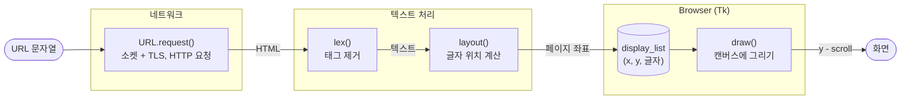
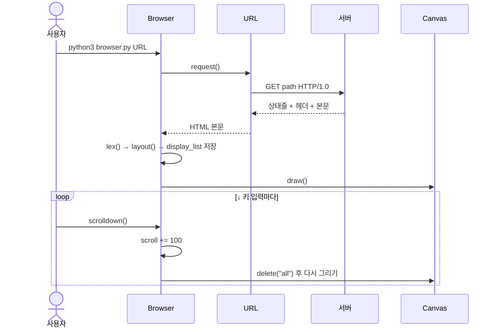

# inside-browser

## 아키텍처

- **layout은 한 번만 실행된다.** 결과(`display_list`)를 저장해 두고, 스크롤할 때는 `draw`만 다시 실행한다.
- **좌표계는 두 가지다.** 페이지 좌표(`layout`이 계산)에서 `self.scroll`을 빼면 화면 좌표(`draw`가 그림)가 된다.

 
 

## 실행 흐름

